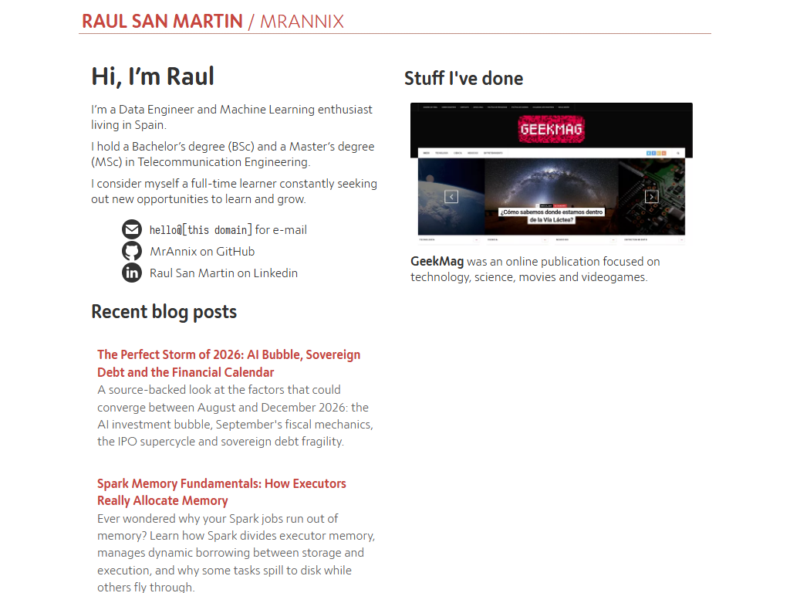

# MrAnnix.github.io

Source of [raulsanmartin.me](https://raulsanmartin.me/), the personal website and tech blog of Raúl San Martín Aniceto ([@MrAnnix](https://github.com/MrAnnix)), built with [Jekyll](https://jekyllrb.com/).

| Environment | Branch | Status | URL |
|:--|:--|:--|:--|
| Production | `master` | [](https://github.com/MrAnnix/MrAnnix.github.io/actions/workflows/deploy-prod.yml) | [raulsanmartin.me](https://raulsanmartin.me/) |
| Development | `develop` | [](https://app.netlify.com/sites/dev-raulsanmartin-me/deploys) | [dev.raulsanmartin.me](https://dev.raulsanmartin.me/) |



## Features

- Blog with category and tag index pages
- Atom (`/feed.xml`) and JSON (`/feed.json`) feeds, and an XML sitemap (`jekyll-sitemap`)
- Code highlighting with Rouge, plus opt-in MathJax and Mermaid per post
- Post comments through [CommentBox](https://commentbox.io/)
- Contact page with e-mail address and PGP key
- `.well-known/` with `dat://` discovery and an OpenPGP Web Key Directory
- Self-hosted fonts (Moniker, Bryant Condensed, Iosevka Term) and Font Awesome 4.7 icons from unpkg

## Local development

Requires Ruby 3.3, the version in [`.ruby-version`](.ruby-version) (also used by CI and Netlify), and Bundler. Jekyll is 3.10, pinned by the `github-pages` gem.

```bash
bundle install
bundle exec jekyll serve --livereload    # http://localhost:4000
```

Useful flags:

- `--drafts` also renders the posts in `_drafts/`.
- `--config _config.yml,_config_dev.yaml` applies the overrides the development site uses.

Before opening a pull request, run the same checks as CI:

```bash
bundle exec jekyll build
bundle exec htmlproofer ./_site --only-4xx --ignore-status-codes "403,429" --checks Images,Scripts,Links,Favicon,OpenGraph
```

HTMLProofer also checks external links, so it needs network access.

## Writing a post

1. Copy [`_drafts/1978-01-01-template.md`](_drafts/1978-01-01-template.md) to `_drafts/<slug>.md` and preview it with `--drafts`.
2. Fill in the front matter:

   ```yaml
   ---
   layout: post
   title: "Your Post Title"
   description: "One or two sentences for the post list, feeds and link previews."
   last_modified_at: 2025-11-08 12:00 +0100
   image: "/assets/images/blog/<slug>.webp"
   categories: "Machine-Learning"
   tags: [AI, Machine Learning]
   mathjax: true    # optional: loads MathJax
   mermaid: true    # optional: loads Mermaid
   ---
   ```

3. Put the post's images in `assets/images/blog/<slug>/`, preferably as WebP.
4. To publish, move the file to `_posts/YYYY-MM-DD-<slug>.md`.

The URL is `/:categories/:title/` (see [`_config.yml`](_config.yml)), so `categories` becomes part of the path. A string with spaces is split into several categories (`"Big Data"` gives `/big/data/<slug>/`); use a hyphen or a YAML list (`[Big Data]`) for a single multi-word category. Changing a published post's category changes its URL.

## Project structure

| Path | Purpose |
|:--|:--|
| `_config.yml` | Site settings for production |
| `_config_dev.yaml` | Overrides for the development site |
| `_layouts/`, `_includes/` | Page templates; `head.html` picks each page's stylesheet |
| `_posts/`, `_drafts/` | Published and draft posts |
| `_sass/`, `assets/css/` | SCSS partials and the per-page stylesheets that import them |
| `assets/` | Images, fonts and JavaScript |
| `static/` | Images referenced from the author's e-mail signature; keep their URLs stable |
| `.well-known/` | `dat://` discovery and the OpenPGP Web Key Directory |
| `.github/` | CI workflows and Dependabot configuration |
| `netlify.toml` | Netlify build environment |

## Deployment

- **Production**: every push to `master` runs [Deploy Production Site](.github/workflows/deploy-prod.yml), which builds the site, checks it with HTMLProofer and publishes it to GitHub Pages.
- **Pull requests**: [Validate Pull Request](.github/workflows/validate-pr.yml) runs the same build and checks without deploying, and Netlify publishes a deploy preview.
- **Development**: Netlify builds the `develop` branch with `_config_dev.yaml` and publishes it to the development site.

Both domains are proxied through Cloudflare. Dependency updates are configured in [`.github/dependabot.yml`](.github/dependabot.yml).

## License

[MIT](LICENSE). Contact details are on the [contact page](https://raulsanmartin.me/contact/).
